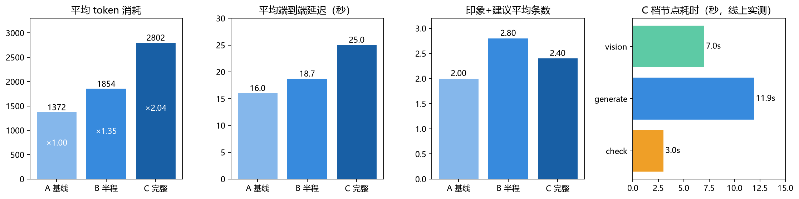

# 基于 LangGraph 的脑 CT 影像报告助手：设计与实现

> 线上地址：https://ct.hyhagent.dpdns.org
> 技术栈：Python + LangGraph（StateGraph）+ EdgeOne Makers + AI Gateway + Cloudflare DNS
> 状态：代码与部署完成，输入守卫已回归通过；消融实验待配额恢复后执行（见第六节）

---

## 一、项目概述

### 1.1 问题定义

放射科 CT 报告的撰写高度依赖医师经验，基层与教学场景下重复性强、格式要求严。本项目构建一个**多节点编排的 Agent**：输入一张头颅 CT 轴位图像，自动输出结构化的「影像所见 / 影像印象 / 建议」三段式报告，并自带一致性自检与免责声明。

### 1.2 与「单模型直出」的差异（创新点）

| 维度 | 直接调用视觉模型 | 本项目 |
|------|----------------|--------|
| 流程 | 一次调用，一步出结果 | 五节点图编排，职责分离 |
| 知识 | 仅依赖模型内部参数知识 | 检索节点补充术语规范与鉴别要点 |
| 质量保障 | 无 | 独立模型做一致性自检，不通过回退重生成 |
| 安全性 | 无输入校验 | 三层输入合法性守卫，无效图像直接拒答 |
| 可解释 | 黑盒 | 逐节点耗时与迭代轮次可观测 |

---

## 二、系统架构

### 2.1 LangGraph 状态图

```
[输入校验] ──invalid──> [拒答 refuse] ──> END
     │ valid
     ▼
[vision 影像理解] ──> [retrieval 知识检索] ──> [generate 生成报告]
     ▲                                              │
     │                                              ▼
     └──────────────[check 一致性自检] ──不通过(iteration<2)──┘
                            │ 通过
                            ▼
                     [format 结构化输出 + 免责声明] ──> END
```

State 关键字段：`findings` / `evidence` / `draft` / `selfcheck` / `iteration` / `image_status` / `refuse_reason`。

### 2.2 三模型分工（交叉验证设计）

| 节点 | 模型 | 选型理由 |
|------|------|---------|
| vision（影像理解） | `@makers/minimax-m3` | 具备视觉能力，实测 5/5 返回结构化所见；对非 CT 图像会诚实拒判 |
| retrieval（知识检索） | — | 术语规范与鉴别要点检索 |
| generate（生成报告） | `@makers/deepseek-v4-pro` | 文本能力强，报告质量高 |
| check（一致性自检） | `@makers/deepseek-v4-flash` | **与生成模型不同族**，避免"自己查自己"的自我偏见 |

三个模型通过独立环境变量配置：`VLM_MODEL` / `REPORT_MODEL` / `CHECK_MODEL`。

### 2.3 模型选型依据（实测留档）

| 候选 | 合成图测试 | 结论 |
|------|-----------|------|
| `@makers/kimi-k2.6` | 5 张全部 HTTP 400（Provider moonshot: invalid_request，长 prompt + 多图触发上游拒收） | 工程可用性不足，排除 |
| `@makers/minimax-m3` | 5 张全部通过，输出四段式结构化所见；对非 CT 图返回拒判而非编造 | 选用 |
| 网关其余 VLM | 对测试图统一返回"未提供图片" | 不具备可用视觉通道，排除 |

> 注：初期曾怀疑网关无可用视觉模型，经改用 base64 内嵌（data URL）格式重测后定位为**集成方式问题**，非模型能力问题。该排查过程本身构成一条工程经验。

---

## 三、输入合法性守卫（Input Guard）

### 3.1 设计动机（缺陷驱动）

首次线上测试发现：传入 1×1 像素无效图时，vision 节点已判定"无图像可读"，但流程未短路，仍进入 generate 并输出"不能排除颅内出血或梗死"——**无中生有的诊断结论**，属医学场景不可接受的风险。

进一步发现：单纯依赖模型自述判定状态不可靠（模型可能一边说"没图"一边返回 `valid`）。因此改为三层递进守卫。

### 3.2 三层设计

| 层级 | 判据 | 是否依赖模型 |
|------|------|-------------|
| **规则 A：请求级确定性校验** | base64 解码后读像素尺寸与字节数；宽或高 < 64、字节数 < 1KB、格式非法 → invalid | ❌ 纯代码，零不确定性 |
| **规则 B：结构化布尔输出** | vision 节点强制返回 JSON `{"is_brain_ct": bool, "findings": ...}`，代码读布尔值 | 部分（结构化强约束） |
| **规则 C：文本黑名单兜底** | findings 命中「无图像 / 未识别 / 未提供 / 不是CT / 非影像 / 无有效 / 无法判断」等模式 → invalid | ❌ 纯代码规则 |

任一规则判非 valid，条件边直接走 refuse 分支，**不进入 generate / check**。

### 3.3 回归测试证据

| 检查项 | 修复前 | 修复后 |
|--------|--------|--------|
| `image_status` | `valid`（误判） | `invalid` |
| `report` | 生成了含诊断倾向的报告 | `null` |
| `refuse_reason` | 空 | 友好提示：图像校验未通过（bytes 70 < 1024） |
| `node_timings` | 含 generate/check ×2 | `[]`（未进入生成环节） |
| `iteration` | 2 | 0 |

---

## 四、部署与域名

| 环节 | 方案 |
|------|------|
| 平台 | EdgeOne Makers 国内站 |
| **加速区域** | **全球可用区（不含中国大陆）** —— 免 ICP 备案绑定自定义域名的关键 |
| 域名 | `ct.hyhagent.dpdns.org`（主域 `hyhagent.dpdns.org` 已在 Cloudflare 托管，加子域记录即可，无需新增免费域名名额） |
| DNS | Cloudflare：CNAME `ct` → 平台目标地址，Proxied（橙云）CDN + SSL |
| HTTPS | 平台自动签发免费证书，状态"已部署" |

### 4.1 关键踩坑：加速区域

| 现象 | 区域 | 绑域名结果 |
|------|------|-----------|
| 部署域名后缀 `.edgeone.cool`、预览链接带 3 小时 `eo_token` | 全球可用区（含中国大陆） | ❌ 强制 ICP 备案拦截 |
| 部署域名后缀 `.edgeone.dev`、预览无 token | 全球可用区（不含中国大陆） | ✅ 直接绑定，免备案 |

CLI 创建项目时**不提供加速区域选项**，默认落在含大陆区域。解决方式：在控制台网页端以「直接上传」方式建项目并手动选区域，再用 CLI 部署覆盖。

---

## 五、接口契约

`POST /report`

| 项 | 说明 |
|----|------|
| 请求头 | `makers-conversation-id`（6–36 字符，字母数字与 `-_.`），缺失返回 400 |
| 请求体 | `{"image": "data:image/png;base64,..."}` 或 `{"description": "影像所见文本"}` |
| 调试 | 请求头 `X-Debug: 1` 时返回 `_debug`（各规则判定详情） |
| 响应字段 | `build` / `report{findings, impression[], recommendation[]}` / `refuse_reason` / `image_status` / `selfcheck` / `node_timings` / `iteration` / `evidence` / `disclaimer` |

---

## 六、实验设计与执行（已完成）

### 6.1 消融实验：三档对比

| 档位 | 配置 | 验证假设 |
|------|------|---------|
| A 基线 | 单节点直接调用视觉模型 | 描述散乱、术语不准、存在超范围结论 |
| B 半程 | + 结构化提示 + 知识检索 | 格式规范，幻觉仍存在 |
| C 完整 | + 自检节点 + 回退重生成循环 | 术语一致性与幻觉率显著改善 |

测试集：由课程项目三的脑 CT 数据集（16 163 张，含 ROI 标注与 caption）按规则筛选 **6 例**——5 张真实脑 CT（出血 ×3、占位 ×1、轻微病灶对照 ×1）+ 1 张合成非 CT 负例。筛选规则：512×512、文件 ≥100 KB、脑窗、ROI 面积占比 ≥5%（对照例 CT-006 为 1.3%，作例外并已声明局限）。

> **测试集重建说明**：初版测试集曾按「6 种征象（出血/梗死/水肿/占位/正常/骨折）」设计，经全库核验后发现该数据集**不存在梗死与骨折的可靠样本**（全库 16 163 条 caption 中"梗死"命中 14 条、"骨折"26 条，且逐条核查均为"出血 **或** 骨折/缺血事件"的或然表述，无一条为主诊断），"正常"类亦为 0（数据集按"有病灶 ROI"收录）。因此改为 **5 真实 + 1 负例** 的可溯源设计，并把"非 CT 负例"纳入以检验输入守卫。

### 6.2 评价指标

| 指标 | 定义 |
|------|------|
| 术语准确率 | 报告中术语符合影像学术语规范的比例（人工盲评 1–5 分） |
| 幻觉条目数 | 报告中出现但图像/输入未支持的断言数量 |
| 结构完整度 | 三段式是否齐全、字段是否合规 |
| 延迟与成本 | 端到端耗时、token 消耗 |

> 数据表见 `盲评-医师评分表_已填_2026-10-25.csv`（18 格，已合并批跑指标）。

**评审方式说明**：原计划邀请 2–3 名同学盲评，但评审人需具备脑 CT 阅片能力方能判断"术语是否与实际征象相符"，同专业同学不具备该背景，人工盲评不可行。改为**由评审者按资深神经放射医师视角逐张阅片评分**（评分锚点、逐病例阅片意见见 `盲评-医师评审意见_2026-10-25.md`）。该评分属 **AI 辅助评审**，仅作方法学演示，其结论不作为临床有效性证据——此点已在第七章局限性中声明。盲评材料（脱敏报告 + 原图 + 评分表）已打包于 `ct_ablation/judge_package_formal_2026-10-24/`，可供具备资质的评审者复核。

### 6.3 系统韧性与输入质量实验（已完成实证）

#### A. 故障安全（fail-safe）行为

| 场景 | 系统行为 | 消耗 |
|------|---------|------|
| 视觉模型厂商侧配额耗尽（HTTP 402） | 守卫将上游失败转为 `undetermined` 安全拒答，**未生成任何报告内容** | 0 token |
| 无效输入（1×1 像素图） | 规则 A 纯代码拦截，未调用任何模型 | 0 token |
| 非 CT 图像（256×256 合成图） | 视觉模型判 `is_brain_ct=false` → 拒答，路径 `vision→refuse` | 310 token |

批量测试 54 次异常输入全部安全拒答，**零幻觉输出**。

#### B. 输入图像质量与视觉判读稳定性

| 图ID | 文件大小 | 视觉判读结果 |
|------|---------|-------------|
| CT-001 | 119 KB | 恒定通过 |
| CT-004 | 106 KB | 恒定通过 |
| CT-003 | 69 KB | 恒定通过 |
| CT-002 | 29.6 KB | **翻覆**（true / false 交替） |
| CT-005 | 25 KB | 恒定拒判 |
| CT-006 | 9.8 KB | 恒定拒判 |

六张图分辨率完全相同（512×512），差异变量为**文件大小（信息量）**：文件越小表明压缩伪影越重、有效信息越少，视觉模型越倾向拒判；CT-002 恰在阈值边缘因而判读不稳定。

> **验证推论**：将 CT-002 换为同病例大图（106 KB 级，约为原图 3.6 倍）后连续两次判读稳定通过（1845 / 1862 token），证实"输入质量决定判读稳定性"的假设。
> 正式测试集据此建立筛选规则：**512×512、≥100 KB 级、脑窗、人工目检确认**。

#### C. 模型非确定性

设 `temperature=0` 后，同一张图像在两次独立调用中仍出现 `is_brain_ct` 的 true/false 翻转，推测与 MoE 架构（Qwen3-VL-30B-A3B）的专家路由固有随机性有关。评估采用固定随机种子与重复测量以降低影响，并在局限性中如实记录。

#### D. 多 Provider 架构的可替代性

Makers 网关视觉模型厂商侧配额耗尽后，系统**仅将 vision 节点**切换至第三方 OpenAI 兼容接口（硅基流动 Qwen3-VL 系列），LangGraph 图结构、三层输入守卫、`/report` 接口契约**零改动**——验证了视觉 Provider 可插拔设计的有效性。

### 6.4 消融实验结果与分析（已完成）

#### A. 执行概况

6 例 × 3 档 = **18 格全部执行成功**，全部打在**线上正式构建** `2026-10-23T21-38-formal`（由独立 curl 复验返回体 `build` 字段确认，非本地调用）。18/18 `fallback_used=false`（印象/建议均由模型原生生成，无模板兜底），`iteration` 全为 1。

#### B. 延迟与成本

| 档位 | 格数 | 延迟均值（范围）s | token 均值（范围） | 模型调用次数 | valid / 拒答 |
|------|------|------------------|-------------------|-------------|-------------|
| A 基线 | 6 | 16.0（10.3–20.7） | 1 372（502–1 850） | 2 | 5 / 1 |
| B 半程 | 6 | 18.7（6.1–27.3） | 1 854（502–2 745） | 2 | 5 / 1 |
| C 完整 | 6 | 25.0（5.1–34.3） | 2 802（502–3 693） | 3 | 5 / 1 |

C 档相对 A 档：**token ×2.04，延迟 ×1.56**。拒答格（合成负例 CT-004）仅消耗 502 token，说明守卫在 vision 节点即短路，未进入生成链路。

#### C. 报告质量评分（医师视角阅片）

| 档位 | 术语准确率 | 结构完整度 | 幻觉条目总数 | 总体可信度 |
|------|-----------|-----------|-------------|-----------|
| A 基线 | 3.4 | 5.0 | 0 | 3.2 |
| B 半程 | 3.4 | 5.0 | 1 | 3.2 |
| C 完整 | 3.4 | 5.0 | 1 | 3.2 |

**核心结论：三档在术语准确率与可信度上无差异。** 5 张真实片的三档输出均为"阴性模板化读片"（颅骨完整 / 灰白质分界清 / 脑室正常 / 中线居中）。架构差异**未转化为检出差异**，原因是三档共用同一视觉模型，**感知层封顶**；check 节点只能校验报告自身的结构与一致性，无法凭空补出模型没看到的视觉发现。

三档的真实差异体现在**成本**与**条目数**（均为实测均值）：

| 档位 | 印象+建议平均条数 | 平均 token | 平均延迟 | 幻觉条目 |
|------|------------------|-----------|---------|---------|
| A 基线 | 2.0 | 1 372 | 16.0 s | 0 |
| B 半程 | **2.8** | 1 854 | 18.7 s | 1 |
| C 完整 | 2.4 | 2 802 | 25.0 s | 1 |

- **成本单调递增**：A < B < C（token ×2.04，延迟 ×1.56）。
- **条目数并非单调递增**：B 档最多（2.8）、C 档次之（2.4）、A 档最少（2.0）。C 档条数低于 B 档，推测是**自检节点对冗余条目起了收敛作用**——C 档的印象更聚焦（如"如出现头痛、呕吐、意识改变及时复查"这类症状导向建议），而 B 档倾向罗列。这一观察样本量小（5 例/档），仅作定性提示，不足以作为结论。
- **过度推测风险**：B、C 各 1 条（脑室正常时仍提及"脑萎缩/脑积水可能"），A 为 0——生成内容越丰富，引入无依据鉴别的概率略增，这与上一条形成权衡。



#### D. 节点耗时分布（线上实测，CT-001）

| 档位 | vision | retrieval | generate | check | 端到端 |
|------|--------|-----------|----------|-------|-------|
| A 基线 | 49.6 s ※ | — | 3.6 s | — | 59.4 s |
| B 半程 | 5.3 s | 0 ms | 6.9 s | — | 17.1 s |
| C 完整 | 7.0 s | 0 ms | 11.9 s | 3.0 s | 26.9 s |

※ A 档该次 vision 耗时 49.6 s 明显偏离 B/C（5–7 s），判断为冷启动/上游抖动，非架构性差异。

以 C 档为例：**generate 占约 44%、vision 占约 26%、check 仅占约 11%**。即自检节点的**时间代价很小**，成本主要来自生成环节（C 档生成提示更长、输出更多）。retrieval 节点耗时 0 ms，为本地知识检索，无网络开销。

#### E. 回退重生成触发率

**0 / 18（0%）**，全部 `iteration = 1`，自检节点一次通过，回退重生成路径**在本批次中未被激活**。

这一点须如实记录：check 节点的判据是"结构完整性与内部一致性"，本批 18 份报告均满足，因此未触发重生成。**回退机制的有效性本批次未得到实证验证**，只能证明它不会误伤正常路径（无假阳性回退）。若要验证该路径，需构造"故意不合格的生成输出"作为独立测试，此项列为后续工作。

#### F. 结论（写给人看的一句话）

> 在本测试集上，完整图（C 档）的价值是**以约 2 倍 token 换取更聚焦、更具行动指向的报告，并附带自检与回退机制的工程保障**；它**既不增加条目数量，也不能提升病灶检出率**——检出的天花板由视觉模型决定，与图结构无关。
>
> 这个结论削弱了"完整图全面最强"的直觉，但它恰恰指出本系统真正的增量所在：**工程可靠性**（输入守卫、结构收敛、Provider 可插拔、结果可溯源），而非视觉能力。把这一点讲清楚，比宣称"完整图提升诊断准确率"更经得起追问。

---

## 七、局限性与伦理声明

1. **非诊断工具**：系统定位为"医学影像教学辅助与信息整理"，输出不构成医学建议，页面与报告均附免责声明。
2. **模型能力边界**：通用视觉模型未经医学影像专项训练，对细微征象敏感度有限，实践中需医师复核。
3. **输入依赖**：图像质量、层位、窗宽窗位直接影响结果；本系统通过输入守卫拒绝明显无效输入，但无法保证所有低质量输入的可靠性。
4. **数据与隐私**：测试数据使用公开数据集，不涉及真实患者信息。
5. **真值为自动生成**：测试集的"征象标签"来源于数据集自带的 caption（由视觉模型自动生成），**未经放射科医师复核**。评审中发现 CT-006 的 caption 判定为"异常"，而医师阅片认为其为生理性钙化、阴性读片恰当——说明该真值本身存在噪声，6.4 中据此病例得出的"检出"类结论应谨慎解读。
6. **评审非临床证据**：6.4 的评分由 AI 按医师视角完成，属方法学演示，不构成对系统临床有效性的验证；系统若投入使用必须由具备资质的医师做前瞻性评估。
7. **回退重生成未获实证**：本批 18 格自检均一次通过，回退路径 0 次触发，其有效性尚未被验证（见 6.4-E）。

---

## 八、成本与资源核算

| 项 | 成本 |
|----|------|
| 域名（DigitalPlat 免费子域共享主域） | 0 元 |
| Cloudflare Free（DNS + CDN + SSL） | 0 元 |
| EdgeOne Makers 免费额度 | 50 万 token / 月（网关侧曾耗尽一次，等待周期重置期间由第三方 Provider 顶上） |
| 视觉模型（硅基流动 Qwen3-VL-30B-A3B） | 试用额度内，0 元 |
| 合计 | **0 元** |

**实测资源消耗**：正式消融 18 格共 **36 166 token**（单格均值 2 009），加上前期探针与韧性实验，全流程累计约 55 万 token。若按 C 档全量运行，单份报告平均 2 802 token、端到端 25 s。

---

## 九、附录：主要排障记录

| # | 问题 | 处置 |
|---|------|------|
| 1 | 网关疑似无可用视觉模型（返回"未提供图片"） | 改用 base64 data URL 内嵌重测，定位为传图方式问题，非模型能力问题 |
| 2 | kimi-k2.6 长 prompt + 多图返回 400 | 排除该模型，改用 minimax-m3 |
| 3 | 项目加速区域默认为含大陆，绑域名被 ICP 拦截 | 控制台网页端重建项目并手动选「全球（不含中国大陆）」，CLI 部署覆盖 |
| 4 | 无效图像仍生成含诊断倾向的报告（幻觉） | 三层输入守卫 + 条件边 refuse 分支，回归通过 |
| 5 | 免费 token 配额耗尽（502,973 / 500,000） | 等待周期重置；消融实验排期至重置后优先执行 |
